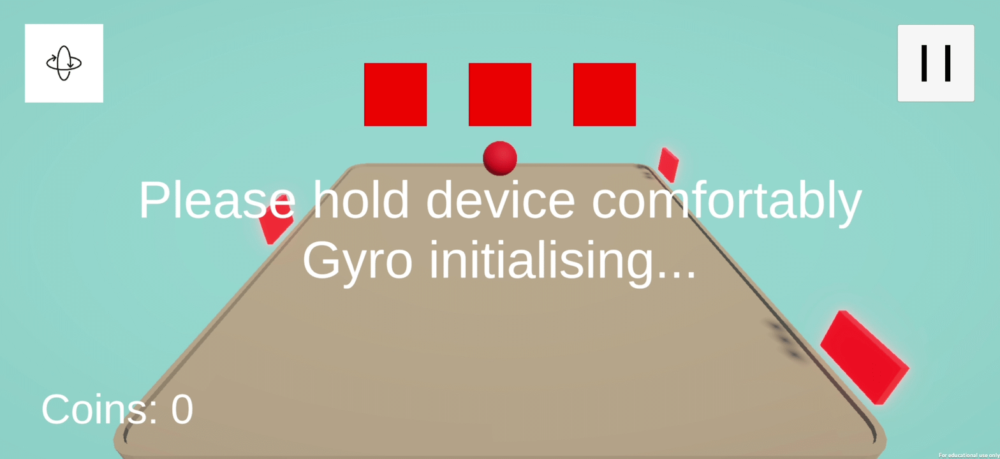
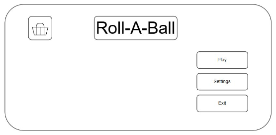
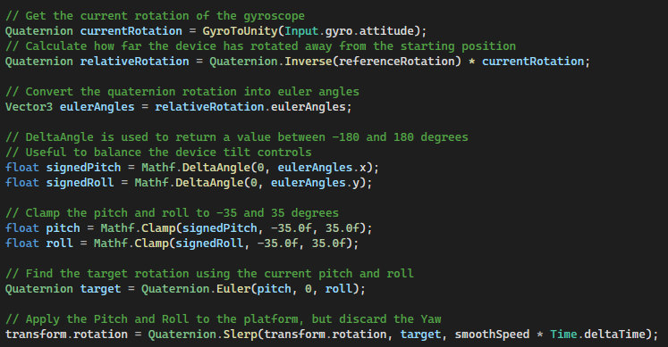

# Roll-A-Ball

*Developed by Jacob Beason Entwistle as part of a Mobile Game Development module.*

<!-- Include picture/GIF of gameplay -->

*Figure 1 - A brief gameplay clip of a player trying to collect coins and dodge the moving laser gates (click to see a full video).*

## Overview

Roll-A-Ball (play on words for rollable) is an **Arcade/Survival** game where you must try to survive as long as possible and collect as many coins as you can. You must dodge obstacles like lasers as you only have 3 lives.

The game uses your phones built-in gyroscope to tilt a board in order to roll the player (the ball). The rotation of the board is clamped at 35 degrees in 4 directions: forward, back, left and right.

The UI in the gameplay is fairly straightforward presenting the player with their survival time, the number of hearts remaining, the current coins collected, a pause button in the top right and a gyro recalibration button in the top left.

<!-- Maybe show a mock visual of the UI here -->

*Figure 2 - An early mock version of the main menu screen showing the shop icon, the title, and the three main buttons: play, settings and exit.*

(Exit button was later removed because most mobile users just use mobile OS UI to exit games)

## Architecture & Design Patterns

The C# scripts are organised using clean Object-Oriented Programming (OOP) principles as seen by the individual parts that make up the core gameplay. 

<!-- Show screenshot of gyro input code & comments -->

*Figure 3 - A snippet of code from the gyroscope input script showing how the current rotation gets captured and applied to the boards rotational position.*

The gyroscope input script receives data from the gyroscope and applies transforms to the board. The player then rolls around the board due to the gravity and physics of the rigidbody while also being affected by other elements such as the laser gates which interact with the player's collider. 

## Specifications

Unity Version: `6000.3.27f2`

Target Platform & OS: `Android 7.1 "Nougat"` or higher (Minimum API Level 25)

Screen Orientation: `Landscape` (Locked)

Input Hardware Required: `Mobile Gyroscope`

## Frameworks & External Services

## User Manual & Controls Guide

<!-- How to tilt the device to steer -->
* Hold the device comfortably and tilt it left, right, fowards or back to tilt the board in that direction

<!-- Explain how gyro calibration/recentring works -->
* If the gyro controls don't feel right, you can press the recalibrate button in the top left of the screen during gameplay
* If the gyro doesn't seem to connect at all, open the pause menu and press the `restart` button

<!-- What each hazard does -->
* There are moving laser gates that deal 1 heart of damage each collision
* When you lose a heart, you respawn and have 3s of immunity
